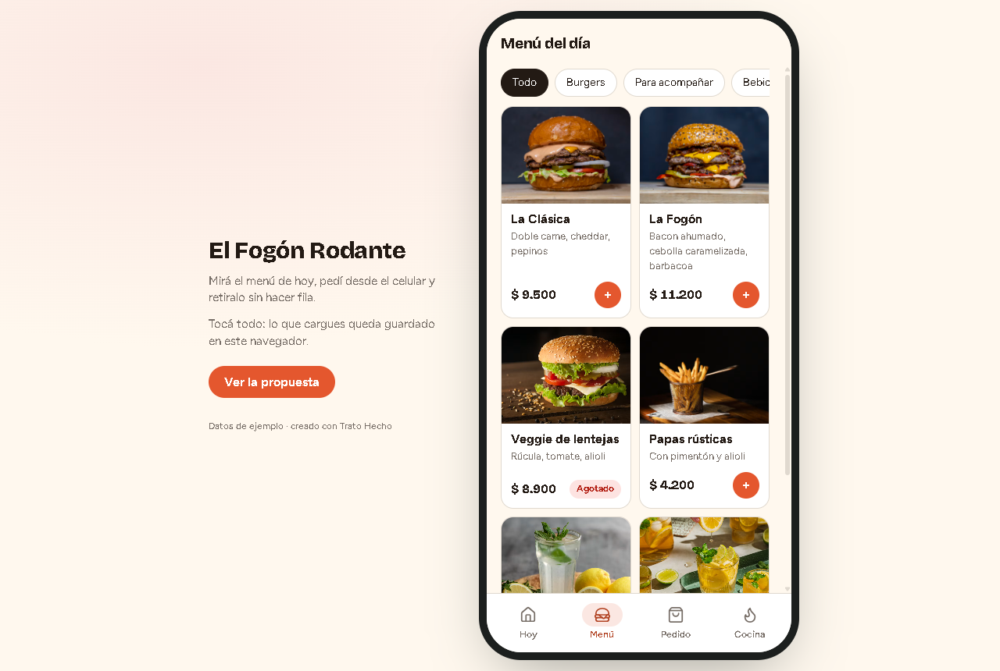
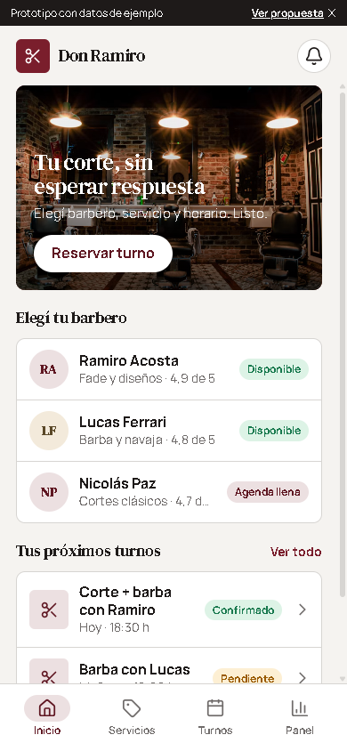
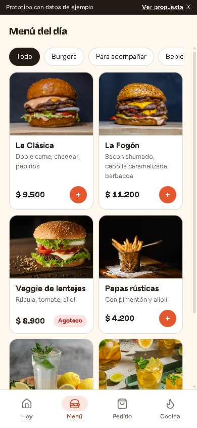
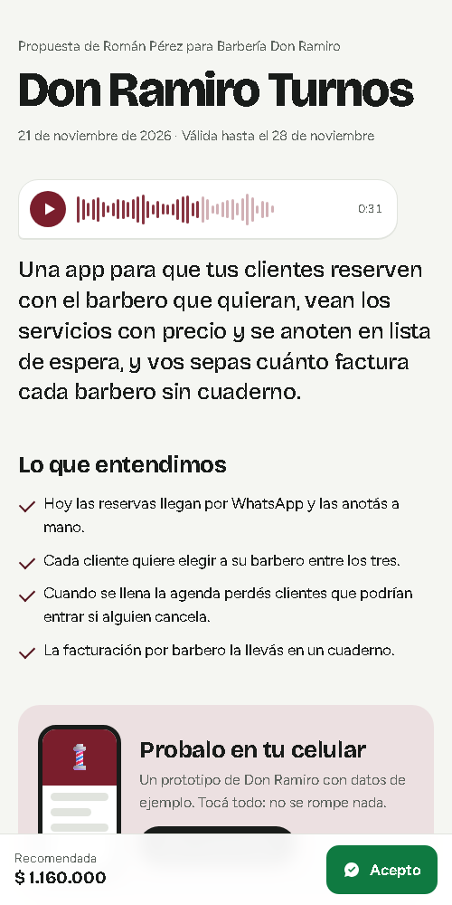

# Trato Hecho

**Del audio de WhatsApp del cliente al “¡trato hecho!”, en 5 minutos.**

Plugin de Claude Code para freelancers y agencias chicas de LATAM que venden desarrollo. Le pasás el audio en el que tu cliente te cuenta lo que necesita y te devuelve el brief, la cotización con 3 opciones, un prototipo navegable publicado con link y QR, y la propuesta lista para mandar por WhatsApp.



## Probalo sin instalar nada

Tres ejemplos generados a partir de audios de clientes, publicados tal cual salen:

| Cliente | Prototipo | Propuesta |
|---|---|---|
| Veterinaria Patitas | [trato-veterinaria-patitas.vercel.app](https://trato-veterinaria-patitas.vercel.app/) | [propuesta](https://trato-veterinaria-patitas.vercel.app/propuesta/) |
| Barbería Don Ramiro | [trato-barberia-don-ramiro.vercel.app](https://trato-barberia-don-ramiro.vercel.app/) | [propuesta](https://trato-barberia-don-ramiro.vercel.app/propuesta/) |
| Food truck El Fogón Rodante | [trato-foodtruck-el-fogon.vercel.app](https://trato-foodtruck-el-fogon.vercel.app/) | [propuesta](https://trato-foodtruck-el-fogon.vercel.app/propuesta/) |

Abrilos desde el celular: así los ve el cliente.

## El problema

Tu cliente te pide todo por audio de WhatsApp. Pasar de ese audio a una propuesta lleva días: escucharlo, entenderlo, estimar, armar algo para mostrar. Mientras tanto, el cliente se enfría o se va con otro.

## Instalación

En Claude Code:

```
/plugin marketplace add Rom4n10/trato-hecho
/plugin install trato@trato-hecho
```

Después corré **`/trato:setup`**: te pide una clave gratis de Groq para transcribir, tu tarifa por hora, moneda, nombre y WhatsApp, y verifica que todo esté listo.

Requisitos: Node 20 o más nuevo. Para publicar los links, una cuenta gratis de Vercel (`npx vercel login` o un token); sin Vercel, Trato Hecho levanta un preview en tu red local.

## Uso

```
/trato:crear ruta/al/audio-del-cliente.ogg
```

¿Todavía no tenés un audio? Probalo con uno de ejemplo:

```
/trato:crear ejemplo barberia
```

Acepta `.ogg`, `.opus`, `.m4a`, `.mp3`, `.wav`, `.webm` y también `.txt` con lo que pidió el cliente. Agregá `--sin-deploy` para no publicar en Vercel.

## Qué genera

Todo queda en `trato-out/<cliente>/`:

| Archivo | Qué es |
|---|---|
| `transcripcion.md` | Lo que dijo el cliente, limpio |
| `brief.md` | Problema, usuarios, funcionalidades, pantallas, supuestos y **preguntas abiertas para el cliente** |
| `cotizacion.json` | Funcionalidades con horas y 3 opciones (Esencial, Recomendada, Completa) calculadas por un script |
| `site/index.html` | Prototipo navegable, mobile-first, con datos de ejemplo creíbles |
| `site/propuesta/index.html` | Propuesta para el cliente con botón **"Acepto por WhatsApp"** en cada opción |
| `mensaje-whatsapp.txt` | El mensaje para pegarle al cliente con los dos links |
| `qr.svg` | QR del prototipo para abrirlo desde el celular |

| Prototipo | Menú con carrito | Propuesta |
|---|---|---|
|  |  |  |

## Cómo funciona

```
audio ──► transcribe.mjs (Groq Whisper) ──► texto
                                              │
                         Claude escribe: brief.md · cotizacion.json · app.json
                                              │
          quote.mjs ◄─────────────────────────┤   horas y precios (Claude no hace cuentas)
                                              │
          publicar.mjs ──► motor de prototipos + propuesta ──► Vercel ──► links + QR + mensaje
```

- **Claude decide, los scripts calculan.** Claude elige qué funcionalidades van en cada opción y su complejidad; `quote.mjs` saca horas, precios y plazos con una tabla fija y tu tarifa. Los números siempre cuadran.
- **Prototipos con un motor probado.** Claude no escribe HTML: describe pantallas y datos en `app.json` y un motor de un solo archivo arma la app con navegación, formularios que guardan, carrito, filtros, búsqueda, mapa y estados vacíos. Es más rápido y nunca sale roto. Hay 5 estilos según el rubro (salud, barbería, comida, bienestar, servicios).
- **Sin dependencias.** Scripts en Node 20 puro: `fetch`, `FormData`, un servidor estático y un generador de QR propios.

## Costos por corrida

- **Transcripción:** Groq tiene capa gratuita; un audio de un minuto cuesta una fracción de centavo.
- **Claude:** entra en el uso normal de tu plan de Claude Code.
- **Publicación:** el plan gratuito de Vercel alcanza.

## Preguntas frecuentes

**¿Qué audios acepta?** Los de WhatsApp (`.ogg`/`.opus`) y casi cualquier otro. Formatos raros (`.aac`, `.amr`) se convierten con ffmpeg si lo tenés instalado.

**¿Puedo cambiar mi tarifa?** Sí: `/trato:setup`, o `node scripts/config.mjs set tarifaHora=35 moneda=USD`.

**¿Qué pasa si no tengo Vercel?** Se levanta un preview en tu red local y el QR apunta ahí: tu celular tiene que estar en el mismo Wi-Fi.

**¿Y si el cliente habla en otro idioma?** Se transcribe igual y todo se arma en español.

**¿Puedo ajustar el prototipo?** Editá `trato-out/<cliente>/app.json` (o pedíselo a Claude) y corré `node scripts/publicar.mjs trato-out/<cliente>`.

## Privacidad

El audio solo viaja al proveedor de transcripción (Groq, u OpenAI si lo configurás). Tus claves quedan en `~/.trato/config.json` (en macOS y Linux, con permisos solo para tu usuario) y nunca se muestran completas. El prototipo usa datos de ejemplo, no datos reales del cliente.

## Desarrollo

```
npm test                         # 48 tests con node:test
node scripts/doctor.mjs          # diagnóstico
claude --plugin-dir .            # probar el plugin local
claude plugin validate .
```

Cómo se construyó con Claude Code: [docs/como-se-construyo.md](docs/como-se-construyo.md). Pruebas: [docs/pruebas.md](docs/pruebas.md).

## Licencia

MIT
